# MD Easin Arafat Sumon

Digital marketer in Dhaka. I run ads and grow online shops, and I build the tools my work needs by describing them to AI. I don't write the code myself.

[mdeasin.webgrowths.com](https://mdeasin.webgrowths.com) · [Email](mailto:easinarafatsumon@gmail.com) · [LinkedIn](https://www.linkedin.com/in/easin-arafat-sumon) · [Facebook](https://www.facebook.com/Easin.Arafat.SumonS) · [Instagram](https://www.instagram.com/e_a_sumon) · [Threads](https://www.threads.com/@e_a_sumon)

 

<picture>
  <source media="(prefers-color-scheme: dark)" srcset="assets/order-journey-dark.svg" />
  <source media="(prefers-color-scheme: light)" srcset="assets/order-journey-light.svg" />
  
</picture>

## Pineapple CRM

An order-management CRM for online shops in Bangladesh. It started as a side project for my own marketing work and is now used every day by real businesses.

- Orders arrive from the WooCommerce shop on their own
- The team calls each customer, confirms the order and books Steadfast, Pathao or RedX
- Delivery, returns and cash are tracked in one place
- Ad results match every order to the Facebook campaign, ad set and ad that brought it, so I can see which ads really sell, not just which ones get clicks

[Visit pineapple.webgrowths.com →](https://pineapple.webgrowths.com)

<!-- CRM demo GIF goes here -->

## How I build

| Step | What I do | Tools |
| --- | --- | --- |
| Find the problem | Notice what slows down my daily marketing work | Notion, Google Sheets |
| Describe it | Explain what I need in plain words, screen by screen | Claude, Lovable |
| Check it | Use every screen the way a customer or agent would | The live app |
| Launch it | Put it online with a real database behind it | Supabase, Vercel |

## Marketing work

Paid social on Meta, Google Analytics to measure what actually works, SEO and content, and design in Canva.
