<!-- ===== Header banner ===== -->


<!-- ===== Typing animation ===== -->
<p align="center">
  <a href="https://github.com/easinasumon">
    
  </a>
</p>

<!-- ===== Social links ===== -->
<p align="center">
  <a href="https://mdeasin.webgrowths.com"></a>
  <a href="mailto:easinarafatsumon@gmail.com"></a>
  <br />
  <a href="https://www.linkedin.com/in/easin-arafat-sumon"></a>
  <a href="https://www.facebook.com/Easin.Arafat.SumonS"></a>
  <a href="https://www.instagram.com/e_a_sumon"></a>
  <a href="https://www.threads.com/@e_a_sumon"></a>
  
</p>

---

## About Me

<table>
<tr>
<td width="60%">

```yaml
name:      MD Easin
location:  Dhaka, Bangladesh
job:       Digital Marketer
hobby:     Building software with AI
coding:    None — I describe it, AI writes it
mindset:   "You don't need to code to build."
```

- By profession I'm a **digital marketer**: growth, ads, content & customers
- I'm **not a developer**: I build tools as a hobby, by talking to AI
- I build what I wish I had at work: tools that save time and show real numbers
- Happy to talk **marketing, e-commerce and AI tools**
- Reach me: [easinarafatsumon@gmail.com](mailto:easinarafatsumon@gmail.com) · [mdeasin.webgrowths.com](https://mdeasin.webgrowths.com)

</td>
<td width="40%" align="center">

</td>
</tr>
</table>

---

## What I've Built with AI

### Pineapple CRM


An order-management CRM for online shops in Bangladesh.
Orders come in from the website, the team calls to confirm,
books the courier, tracks delivery & returns, and sees
**which Facebook ads really bring sales**.

Started as a hobby, now used daily by real businesses.

[pineapple.webgrowths.com](https://pineapple.webgrowths.com)

<!-- CRM demo GIF goes here -->

<picture>
  <source media="(prefers-color-scheme: dark)" srcset="assets/order-journey-dark.svg" />
  <source media="(prefers-color-scheme: light)" srcset="assets/order-journey-light.svg" />
  
</picture>

<br />

<picture>
  <source media="(prefers-color-scheme: dark)" srcset="assets/growth-dark.svg" />
  <source media="(prefers-color-scheme: light)" srcset="assets/growth-light.svg" />
  
</picture>

### AI for Marketing
Using Claude for content ideas,
YouTube workflows and design polish.

`Claude` `AI Agents` `Automation`

---

## Tools I Use

<p align="center"><b>Marketing & Design</b></p>
<p align="center">
  
  
  
  
</p>

<p align="center"><b>Building with AI</b></p>
<p align="center">
  
  
  
  
</p>

<p align="center"><b>Productivity</b></p>
<p align="center">
  
  
</p>

---

<p align="center"><i>A digital marketer who builds with AI: if I can do it, so can you.</i></p>


