  
  
  
  
  
  

## About me

I'm a digital marketer in Dhaka. My day job is growth, ads, content and looking after customers. In my spare time I build software by describing it to AI, screen by screen. I don't write code myself.

- I build the tools I wish I had at work, ones that save time and show real numbers
- I take ideas from a prompt to a live product
- Happy to talk marketing, e-commerce and AI tools

## What I've built with AI

### Pineapple CRM

An order-management CRM for online shops in Bangladesh. Orders come in from the website, the team calls to confirm, books the courier, tracks delivery and returns, and sees **which Facebook ads really bring sales**.

Started as a hobby, now used daily by real businesses. [pineapple.webgrowths.com](https://pineapple.webgrowths.com)

<!-- CRM demo GIF goes here -->

<picture>
  <source media="(prefers-color-scheme: dark)" srcset="assets/order-journey-dark.svg" />
  <source media="(prefers-color-scheme: light)" srcset="assets/order-journey-light.svg" />
  
</picture>

 

<picture>
  <source media="(prefers-color-scheme: dark)" srcset="assets/growth-dark.svg" />
  <source media="(prefers-color-scheme: light)" srcset="assets/growth-light.svg" />
  
</picture>

### AI for marketing

Using Claude for content ideas, YouTube workflows and design polish.

## Tools I use

**Marketing and design**

  
  
  
  

**Building with AI**

  
  
  
  

**Productivity**

  
  

